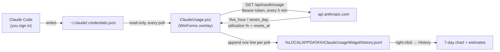

# Claude Usage Widget

A tiny always-on-top Windows overlay that shows how much of your **Claude** plan is left — session and weekly — right on the taskbar. No browser tab, no typing `/usage`.

```
Session ━━━━━━━━━━━━  61% left   2h 14m
Weekly  ━━━━━━━━━━━━  83% left   4d 6h
```

<!-- Screenshot placeholder: docs/screenshots/widget.png (the overlay on the taskbar) -->
<!-- Screenshot placeholder: docs/screenshots/history.png (right-click > History window) -->

## Why

If you use Claude Code all day, the limits are the thing that interrupts you. The numbers exist — Claude Code's `/usage` shows them — but you have to stop and ask. This widget keeps them in the corner of your eye, so you can tell at a glance whether to start that big refactor now or after the reset.

## Features

- **Session (5-hour) and Weekly** usage, each with a colour-coded bar (green > 50% left, amber > 20%, red below) and a countdown to reset
- **Sits on the taskbar** — on the empty left end on Windows 11, draggable anywhere, remembers its position
- **Hover** for exact reset times; **right-click** for Refresh, History, Open usage page, Reset position and Exit
- **History window** — a 7-day line chart of session and weekly utilization recorded locally, with your average burn rate in the current windows and an *estimated* time to hit 100%
- **Polite, resilient polling:**
  - checks every 5 minutes
  - backs off exponentially (up to 30 minutes) when rate-limited, honouring `Retry-After`
  - keeps showing the last-known numbers, marked with an amber dot, for up to an hour
  - retries straight away after you sign in again
- **Zero dependencies** — plain Windows PowerShell 5.1 and WinForms, both built into Windows. No Python, no Node, no installer framework.

## Requirements

- Windows 10 or 11 with Windows PowerShell 5.1 (preinstalled)
- [Claude Code](https://claude.com/claude-code), signed in with a Claude subscription (Pro / Max)

## Install

Clone the repository (or use the green **Code** button → *Download ZIP* and extract it), then run the installer from that folder:

```powershell
git clone https://github.com/tomjose-bv/claude-usage-widget.git
cd claude-usage-widget
powershell -ExecutionPolicy Bypass -File scripts\install.ps1 -Startup
```

That copies the widget to `%LOCALAPPDATA%\Programs\ClaudeUsageWidget`, adds a **Claude Usage Widget** Start menu shortcut, starts it with Windows (`-Startup`, optional), and launches it. No admin rights needed. Re-run the same command to upgrade.

**Uninstall:**

```powershell
powershell -ExecutionPolicy Bypass -File scripts\uninstall.ps1             # keeps your local history
powershell -ExecutionPolicy Bypass -File scripts\uninstall.ps1 -RemoveData # deletes it too
```

**Run without installing:**

```powershell
powershell -NoProfile -ExecutionPolicy Bypass -WindowStyle Hidden -File ClaudeUsage.ps1
```

> `-ExecutionPolicy Bypass` applies only to that one PowerShell process; it doesn't change your system policy.

## How it works



- **Data source:** the OAuth access token Claude Code stores in `~/.claude/.credentials.json`. The widget only reads that file; it never writes or refreshes it. When Claude Code refreshes your login, the widget notices the file change and retries.
- **What it calls:** the same usage endpoint Claude Code's `/usage` command uses. It returns utilization **percentages** and reset times — nothing else.
- **Code layout:**
  - `ClaudeUsage.ps1` — the overlay window, polling loop and menu
  - `ClaudeUsage.Core.psm1` — pure logic (response parsing, countdowns, colour levels, backoff, history file, burn-rate estimates), unit tested
  - `ClaudeUsage.History.ps1` — the History window (`System.Windows.Forms.DataVisualization`, ships with .NET Framework)
- **Single instance:** a named mutex makes sure only one copy runs.

### About the estimates

The History window shows *average burn rate* for each window: percent used divided by time elapsed since the window started (reset time minus 5 hours or 7 days). The *projected time to 100%* assumes you keep going at that average pace. They are rough estimates to help you pace yourself, not predictions — and because the endpoint reports percentages only, the widget shows no token counts or costs.

## Privacy

- Your token is sent **only** to `api.anthropic.com`, over HTTPS, to fetch your usage.
- Credentials are read-only; nothing about them is logged or stored.
- The widget stores two things locally: its screen position (`position.txt` next to the script) and your usage history (`%LOCALAPPDATA%\ClaudeUsageWidget\history.jsonl` — timestamp, the two percentages and reset times, capped at 5,000 samples ≈ 17 days). Neither ever leaves your machine. Delete them any time.
- No telemetry, no analytics, no other network calls.

## Limitations

- **Undocumented endpoint.** `/api/oauth/usage` is what Claude Code uses internally; it isn't a public API and could change or disappear without notice. If it does, the widget will show *Offline* until it's updated.
- **Windows only.** It's built on WinForms and Win32 calls.
- **Percentages only.** No token counts, costs or per-model breakdowns.
- **History only while running.** Samples are recorded when the widget polls, so gaps appear when your PC is off; the chart breaks the line there rather than guessing.
- The endpoint rate-limits aggressive polling, which is why it checks only every 5 minutes.

## Troubleshooting

| What you see | What to do |
|---|---|
| **Login expired - open Claude Code** | Your token expired. Open Claude Code (it refreshes the token) or run `/login`. The widget picks up the new token within a second. |
| **Rate limited, retry in Nm** | The endpoint asked it to slow down. It backs off automatically (up to 30 min) and shows last-known numbers meanwhile — just wait. Avoid spamming *Refresh now*. |
| **Offline, retrying** | No network, or the endpoint changed. It retries every minute. |
| Amber dot instead of green | Showing last-known numbers because the latest check failed; hover for the reason. |
| Nothing appears | Check it isn't already running (only one copy runs), and that `~/.claude/.credentials.json` exists — i.e. you've signed in to Claude Code on this machine. |
| Widget is off-screen | Right-click → *Reset position*, or delete `position.txt` in the install folder. |
| History window is empty | History starts recording when you install this version; give it a few polls. |

## Development

```powershell
# Pester 5+ (one-time)
Install-Module Pester -Scope CurrentUser -Force -SkipPublisherCheck

# Run the tests (core logic, history window helpers, install/uninstall against temp folders)
powershell -NoProfile -ExecutionPolicy Bypass -File tests\Invoke-Tests.ps1
```

The tests never call the API and never create the overlay window, so they're safe to run while the widget is open.

## Roadmap

- [ ] Optional toast notification when a window crosses a threshold (e.g. 80% used)
- [ ] Compact single-line mode
- [ ] Light theme / follow Windows theme
- [ ] Export history as CSV
- [ ] Signed release ZIP

Ideas and PRs welcome — but the goal is to stay a small, glanceable widget, not a dashboard.

## Contributing

1. Fork and branch.
2. Keep logic in `ClaudeUsage.Core.psm1` where it can be tested; keep the UI thin.
3. Add or update Pester tests and make sure `tests\Invoke-Tests.ps1` passes.
4. Use [conventional commits](https://www.conventionalcommits.org/) (`feat:`, `fix:`, `docs:` …).
5. Never commit tokens, credential files or your own usage history.

## License

[MIT](LICENSE)
